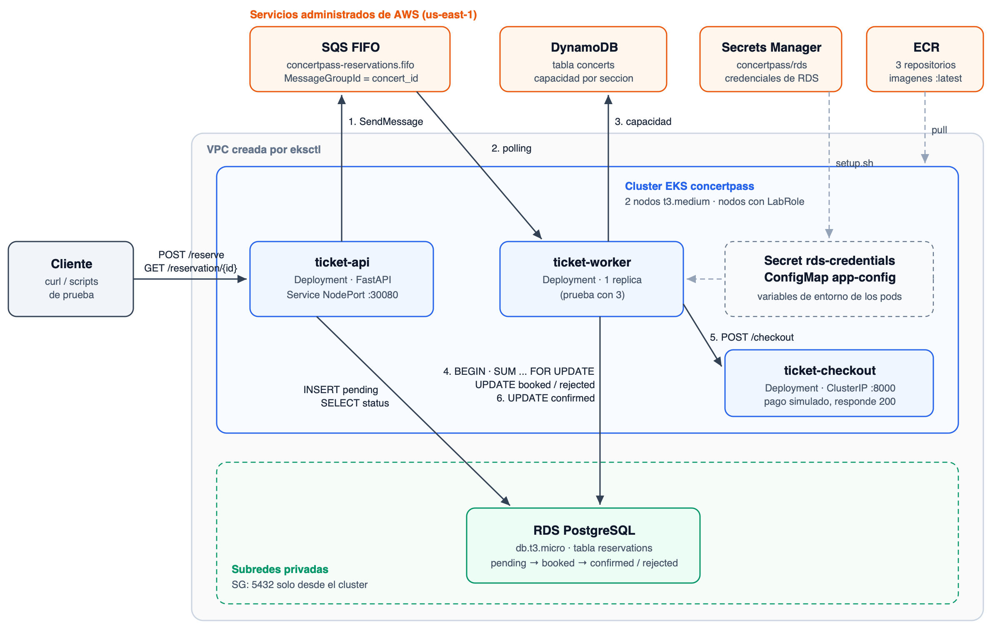

# Concertpass

Sistema de reservacion de boletos para conciertos con tres microservicios en Amazon EKS: `ticket-api`, `ticket-worker` y `ticket-checkout`.



## Infraestructura

Todo se levanta con scripts de bash en `scripts/`. Estan pensados para correr en **AWS CloudShell** dentro de AWS Academy, que ya tiene las credenciales del lab. Como en Academy no se pueden crear roles de IAM, el cluster y los nodos usan `LabRole`.

| Recurso | Nombre | Script |
|---------|--------|--------|
| Cluster EKS (2 nodos t3.medium) | `concertpass` | `01-cluster.sh` |
| Repositorios ECR | `ticket-api`, `ticket-worker`, `ticket-checkout` | `02-ecr.sh` |
| SQS FIFO | `concertpass-reservations.fifo` | `03-sqs.sh` |
| DynamoDB + precarga | `concerts` | `04-dynamodb.sh`, `precarga-dynamodb.sh` |
| RDS PostgreSQL + Secrets Manager | `concertpass-db`, `concertpass/rds` | `05-rds.sh` |
| Secret y ConfigMap en k8s, NodePort | `rds-credentials`, `app-config` | `06-k8s-config.sh` |
| Tabla `reservations` | | `07-db-schema.sh`, `schema.sql` |

### Levantar todo

```bash
git clone https://github.com/Jurdi5/Practica-3-DELN.git
cd Practica-3-DELN
bash scripts/setup.sh
```

Tarda unos 30 minutos (el cluster ~20 y RDS ~10). Al final muestra el estado de los recursos y `kubectl get nodes` con los dos nodos en `Ready`. Cada script se puede correr solo y repetir sin romper nada, por ejemplo si la sesion del lab se corta a la mitad.

### Configuracion que reciben los pods

Los servicios solo leen variables de entorno. `06-k8s-config.sh` crea:

**Secret `rds-credentials`** (copiado de Secrets Manager `concertpass/rds`)

| Llave | Contenido |
|-------|-----------|
| `host` | endpoint de RDS |
| `port` | `5432` |
| `dbname` | `concertpass` |
| `username` | `concertpass` |
| `password` | generada en `05-rds.sh` |

**ConfigMap `app-config`**

| Llave | Valor |
|-------|-------|
| `AWS_REGION` | `us-east-1` |
| `SQS_QUEUE_URL` | URL de `concertpass-reservations.fifo` |
| `DYNAMODB_TABLE` | `concerts` |
| `CHECKOUT_URL` | `http://ticket-checkout-service:8000/checkout` |

Ejemplo en un Deployment:

```yaml
env:
  - name: DB_HOST
    valueFrom: { secretKeyRef: { name: rds-credentials, key: host } }
  - name: SQS_QUEUE_URL
    valueFrom: { configMapKeyRef: { name: app-config, key: SQS_QUEUE_URL } }
```

Los nodos usan `LabRole`, asi que los pods pueden usar SQS, DynamoDB y Secrets Manager sin llaves.

### Red

- RDS esta en las subredes privadas de la VPC del cluster y no es publica.
- Su security group (`concertpass-rds-sg`) solo acepta el puerto 5432 desde el security group del cluster, que es el de los nodos.
- El puerto 30080 (NodePort de `ticket-api`) esta abierto en los nodos para poder probar desde CloudShell.

### Conciertos precargados

| concert_id | floor | vip | general | Uso |
|------------|-------|-----|---------|-----|
| `bad-bunny-gdl` | 100 | 50 | 500 | alta demanda |
| `cuarteto-nos-gdl` | 20 | 10 | 80 | nicho |
| `natalia-lafourcade-mty` | 60 | 30 | 200 | otro concierto |

### Imagenes

Construir en CloudShell (x86_64, igual que los nodos):

```bash
bash scripts/build-push.sh ticket-api <directorio-de-ticket-api>
bash scripts/build-push.sh ticket-worker <directorio-de-ticket-worker>
bash scripts/build-push.sh ticket-checkout <directorio-de-ticket-checkout>
```

Las imagenes quedan en `<cuenta>.dkr.ecr.us-east-1.amazonaws.com/<servicio>:latest`.

### Utilidades

```bash
bash scripts/api-url.sh                 # URL publica de ticket-api (IP de un nodo + 30080)
bash scripts/db-query.sh                # resumen de reservaciones por concierto y estado
bash scripts/db-query.sh "SELECT * FROM reservations ORDER BY created_at DESC LIMIT 10"
bash scripts/verificar.sh               # que recursos existen en la cuenta
```

`db-query.sh` corre `psql` desde un pod del cluster porque RDS no es accesible desde afuera.

Ver los conciertos en DynamoDB:

```bash
aws dynamodb scan --table-name concerts
```

Ver los mensajes en SQS:

```bash
aws sqs get-queue-attributes --queue-url "$(aws sqs get-queue-url --queue-name concertpass-reservations.fifo --query QueueUrl --output text)" --attribute-names ApproximateNumberOfMessages ApproximateNumberOfMessagesNotVisible
```

### Destruir todo

EKS y RDS cobran por hora. Al terminar de trabajar:

```bash
bash scripts/teardown.sh
```

Pide escribir `borrar` para confirmar. Borra los deployments y services, RDS, el subnet group, el security group, el secreto, la cola, la tabla, los repositorios de ECR y el cluster con su VPC. Al final corre `verificar.sh`, que debe mostrar todo como `no existe`. Tarda unos 20 minutos.

### Notas de AWS Academy

- La sesion del lab dura unas 4 horas. Si se acaba, dar Start Lab otra vez y abrir una nueva terminal de CloudShell. Los scripts se pueden volver a correr.
- Al terminar la sesion, Academy detiene las instancias EC2 (los nodos). Conviene levantar, grabar el video y destruir en la misma sesion.
- CloudShell no trae `eksctl`; `00-herramientas.sh` lo instala en `~/bin`.
